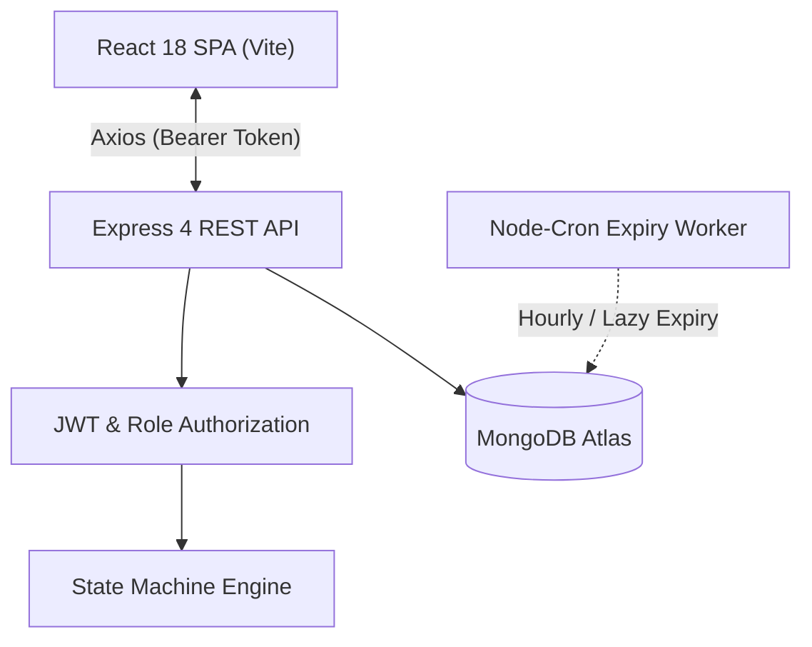
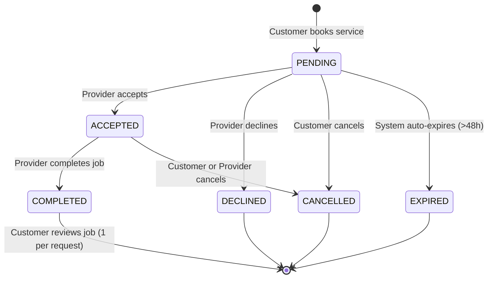

# NearbyPro

A full-stack production-ready MERN marketplace connecting local customers with verified neighborhood professionals (electricians, plumbers, tutors, tailors, carpenters, painters, cleaners, and mechanics) using geospatial distance queries and an atomic request state machine.

---

## Problem Statement

Finding trusted, local service providers like electricians, plumbers, tutors, and tailors is fraught with uncertainty:
- **Location mismatch**: Traditional directories lack accurate geospatial radius matching, resulting in providers who are too far away to accept urgent jobs.
- **Lack of accountability**: Informal verbal agreements lead to unexpected price changes, unverified cancellations, and unfulfilled service requests.
- **Unverified feedback**: Many platforms permit public or fake reviews without verifying whether an actual service transaction occurred.

---

## Target Users

1. **Customers**: Individuals in need of immediate or scheduled local home services who require upfront pricing, location proximity, and verified professional reviews.
2. **Service Providers**: Skilled tradespeople and freelance specialists seeking nearby clients, streamlined booking workflows, and authentic client testimonials.

---

## Solution

NearbyPro provides an end-to-end, accountable platform:
- **2dsphere Proximity Search**: Computes physical distances using MongoDB `$geoNear` aggregation, enabling customers to filter local professionals by exact kilometer radius.
- **Strict Role-Driven Workflows**: Dedicated customer and provider dashboards enforce strict state transitions and access controls.
- **Verified Review Gatekeeping**: Reviews can strictly only be submitted once per completed service request, recalculating average ratings and review counts dynamically.

---

## Key Features

- **Geospatial Proximity Search**: Search services within 1 to 50 km using browser GPS, preset city coordinates, or custom coordinates.
- **Multi-Filter & Debounced Search**: Filter by keyword (400ms debounce), service category, max price, min rating, and sort order (distance, rating, price) with request cancellation (AbortController).
- **Atomic State Machine**: Manages request lifecycle (`PENDING` → `ACCEPTED` → `COMPLETED` / `CANCELLED` / `DECLINED` / `EXPIRED`) with race-safe atomic transitions.
- **Automated Request Expiry**: Scheduled background cron job (`jobs/expireRequests.js`) and lazy fallback expiring overdue pending requests (>48h).
- **Privacy Protection**: Contact details (phone numbers and full street addresses) remain concealed until a request is accepted by the provider.
- **Responsive Minimal UI**: Built with React 18 and vanilla CSS (~100 lines) with zero heavy UI libraries or styling overhead.

---

## Tech Stack

| Layer | Technologies |
|---|---|
| **Backend** | Node.js 18+, Express 4.19, Mongoose 8, ES Modules (`"type": "module"`) |
| **Database** | MongoDB Atlas with `2dsphere` geospatial indexing |
| **Authentication & Security** | JSON Web Tokens (`jsonwebtoken`), `bcryptjs` (10 rounds), `helmet`, `cors`, `express-rate-limit`, `zod` validation |
| **Background Jobs** | `node-cron` scheduled hourly (`0 * * * *`) |
| **Testing** | Node.js built-in test runner (`node:test`, `node:assert`) |
| **Frontend** | React 18, Vite 5, React Router DOM v6, Axios (with auth interceptors) |
| **Styling** | Clean vanilla CSS (`src/index.css`, system font stack, max ~100 lines) |

---

## Architecture

### System Components



### Request Lifecycle



### Data Model Summary

- **`User`**: Manages customer and provider accounts, credential hashes, roles (`customer` | `provider`), and optional contact phones. Password hashes are excluded by default (`select: false`).
- **`Service`**: Holds service descriptions, categories, pricing models (`per_hour` | `per_job`), human address, GeoJSON Point coordinates, and cached aggregate ratings (`avgRating`, `reviewCount`).
- **`ServiceRequest`**: Tracks bookings with immutable historical service snapshots (`serviceSnapshot`), appointment dates, atomic status flags, and chronological transition logs (`statusHistory`).
- **`Review`**: Links directly to a completed `ServiceRequest` (enforcing 1 review per request via a unique index), storing 1-5 integer ratings and customer testimonials.

### Why `$geoNear` and `2dsphere` Index

- MongoDB's `$geoNear` aggregation stage operates directly on spherical geometries using Earth's curvature.
- `$geoNear` **must be the first stage** in an aggregation pipeline and requires a `2dsphere` index on `location`.
- It accurately calculates straight-line distances in meters (`distanceMeters`), enabling real-time distance sorting and kilometer conversions while remaining performant across millions of coordinates.

### Why a Partial Unique Index

- Concurrent race conditions can allow customers to rapidly double-click or submit concurrent booking requests for the same service.
- A standard unique index on `{ customer: 1, service: 1 }` would permanently block a customer from ever hiring that provider again in the future.
- By configuring a **partial unique index** with `partialFilterExpression: { status: { $in: ["PENDING", "ACCEPTED"] } }`, MongoDB guarantees at the database engine level that a customer can only have **one active request at a time** for a given service, while permitting past requests that were `COMPLETED`, `CANCELLED`, or `DECLINED`.

---

## API Summary

| Method | Endpoint | Access | Description |
|---|---|---|---|
| `POST` | `/api/auth/register` | Public | Register customer or provider (Rate limited: 20 req / 15 min) |
| `POST` | `/api/auth/login` | Public | Authenticate user & return JWT (Rate limited: 20 req / 15 min) |
| `GET` | `/api/auth/me` | Protected | Fetch authenticated user profile |
| `GET` | `/api/services/nearby` | Public | Geospatial search (`lat`, `lng`, `radiusKm`, `category`, `q`, `sort`) |
| `GET` | `/api/services/mine` | Provider | Fetch authenticated provider's services |
| `GET` | `/api/services/:id` | Public | Fetch service details and sanitized provider contact |
| `POST` | `/api/services` | Provider | Create new service listing |
| `PATCH`| `/api/services/:id` | Provider | Update existing service listing |
| `DELETE`| `/api/services/:id` | Provider | Soft delete / deactivate service listing |
| `POST` | `/api/requests` | Customer | Create service request with service snapshot |
| `GET` | `/api/requests/mine` | Customer | List customer requests with review status |
| `GET` | `/api/requests/incoming` | Provider | List incoming requests with contact privacy rules |
| `GET` | `/api/requests/:id` | Protected | Fetch individual request details (parties only) |
| `PATCH`| `/api/requests/:id/status` | Protected | Execute race-safe state machine transition |
| `POST` | `/api/reviews` | Customer | Post review for completed request & recalculate service rating |
| `GET` | `/api/reviews/service/:serviceId` | Public | List paginated reviews for a service |
| `GET` | `/api/health` | Public | Application health status check |

---

## Local Setup

### 1. Prerequisites
- Node.js 18+ (tested on Node v24)
- npm 9+
- MongoDB Atlas cluster or running local MongoDB instance (port 27017)

### 2. Clone and Install

```bash
# Backend setup
cd nearbypro/server
npm install

# Frontend setup
cd ../client
npm install
```

### 3. Environment Configuration

Create `nearbypro/server/.env`:
```env
PORT=5000
MONGO_URI=mongodb+srv://<username>:<password>@cluster.mongodb.net/nearbypro?retryWrites=true&w=majority
JWT_SECRET=super_secret_jwt_key_that_is_at_least_32_characters_long_for_security
JWT_EXPIRES_IN=7d
CLIENT_URL=http://localhost:5173
NODE_ENV=development
```

Create `nearbypro/client/.env`:
```env
VITE_API_URL=http://localhost:5000/api
```

### 4. Seed Database

Run the automated seeder script to populate MongoDB with demo accounts and Bangalore services:
```bash
cd nearbypro/server
npm run seed
```

### 5. Start Servers

```bash
# Terminal 1: Backend API (port 5000)
cd nearbypro/server
npm run dev

# Terminal 2: Frontend Client (port 5173)
cd nearbypro/client
npm run dev
```

Visit `http://localhost:5173` in your browser.

---

## Environment Variables

| Variable | Scope | Required | Default | Description |
|---|---|---|---|---|
| `PORT` | Server | No | `5000` | Port for Express HTTP server |
| `MONGO_URI` | Server | **Yes** | — | MongoDB Atlas connection string |
| `JWT_SECRET` | Server | **Yes** | — | Secret string for JWT signing (min 32 characters) |
| `JWT_EXPIRES_IN` | Server | No | `7d` | Token expiration duration |
| `CLIENT_URL` | Server | No | `http://localhost:5173` | Allowed CORS origins (comma-separated list) |
| `NODE_ENV` | Server | No | `development` | Runtime environment (`development`, `production`, `test`) |
| `VITE_API_URL` | Client | No | `http://localhost:5000/api` | Base URL for backend API requests |

---

## Seed & Demo Credentials

All demo accounts are preconfigured with password `Demo@1234`.

| Account Type | Email | Password | Locality / Specialization |
|---|---|---|---|
| **Customer** | `customer@demo.com` | `Demo@1234` | Indiranagar, Bengaluru |
| **Provider 1** | `provider1@demo.com` | `Demo@1234` | Ace Electricals (Indiranagar / Koramangala) |
| **Provider 2** | `provider2@demo.com` | `Demo@1234` | Bengaluru Plumbing Care (Whitefield / Jayanagar) |
| **Provider 3** | `provider3@demo.com` | `Demo@1234` | Bright Minds Tutoring (HSR Layout / Malleshwaram) |
| **Provider 4** | `provider4@demo.com` | `Demo@1234` | Precision Tailors (Electronic City / Indiranagar) |
| **Provider 5** | `provider5@demo.com` | `Demo@1234` | Master Carpenters & Painters (HSR Layout / Koramangala) |

---

## Testing

NearbyPro uses the Node.js built-in test runner (`node:test`) to test the state machine transitions, actor permissions, and terminal rejection rules:

```bash
cd nearbypro/server
npm test
```

Test coverage includes:
- All 7 valid state transitions (`accept`, `decline`, `cancel`, `complete`, `expire`).
- All 20 invalid transition attempts originating from terminal states (`COMPLETED`, `CANCELLED`, `DECLINED`, `EXPIRED`).
- Unauthorized actor roles and cross-role violations (e.g., customers attempting to accept requests).
- Invalid action verbs and corrupted state inputs.

---

## Deployment

### Backend on Render
1. Create a new **Web Service** on [Render](https://render.com/).
2. Connect your Git repository.
3. Configure settings:
   - **Root Directory**: `nearbypro/server`
   - **Environment**: `Node`
   - **Build Command**: `npm install`
   - **Start Command**: `npm start`
4. Set Environment Variables in Render Dashboard:
   - `MONGO_URI`: Your MongoDB Atlas URI (ensure Atlas Network Access whitelist is set to `0.0.0.0/0`)
   - `JWT_SECRET`: Random 32+ character secret string
   - `CLIENT_URL`: `https://nearbypro.vercel.app` (your Vercel frontend URL)
   - `NODE_ENV`: `production`

> [!NOTE]
> The Render free tier spins down inactive instances. Initial requests may take approximately 50 seconds while the web service awakes. Test `https://<render-url>/api/health` first before running a demo.

### Frontend on Vercel
1. Create a new Project on [Vercel](https://vercel.com/).
2. Select your repository and set:
   - **Root Directory**: `nearbypro/client`
   - **Framework Preset**: `Vite`
   - **Build Command**: `npm run build`
   - **Output Directory**: `dist`
3. Set Environment Variable in Vercel:
   - `VITE_API_URL`: `https://<your-render-url>/api`
4. Deploy. The `vercel.json` SPA configuration ensures all client routes resolve to `/index.html`.

### Live Links (Placeholders)
- **Live Frontend**: `https://nearbypro.vercel.app`
- **Live Backend API**: `https://nearbypro-api.onrender.com/api`

---

## Security Measures

1. **Strict Input Validation**: Zod schemas validate all incoming parameters, queries, and bodies, rejecting non-strings to eliminate NoSQL injection vulnerabilities (e.g. `{"$gt": ""}`).
2. **Fail-Fast Environment Validation**: `config/env.js` prevents application startup if `MONGO_URI` or a sufficiently strong `JWT_SECRET` (≥32 chars) is missing.
3. **HTTP Security Headers**: `helmet` enforces secure CSP, HSTS, and X-Content-Type headers.
4. **Rate Limiting**: Authentication endpoints are rate-limited to 20 requests per 15 minutes per IP.
5. **Contact Privacy**: Client phone numbers and street addresses are masked until the provider accepts the booking.
6. **Authorization Enforcement**: User identity and role permissions are derived strictly from verified JWT tokens on `req.user`, never from client-submitted parameters.

---

## Known Limitations & Future Work

- **Real-Time Push Notifications**: Currently uses polling/refetching on state updates; integrating WebSockets (Socket.IO) would provide instant provider notification alerts.
- **In-App Messaging / Chat**: Communication currently occurs through phone upon request acceptance; in-app direct messaging would further enhance accountability.
- **Payment Gateway Integration**: Future milestones could incorporate escrow payment releases (e.g., Razorpay / Stripe) upon job completion.
